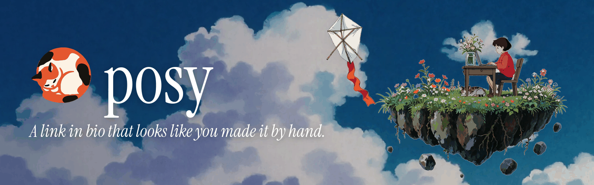

# Posy brand kit

Posy is a link in bio that looks like you made it by hand. The brand should feel the same: warm, a little hand-made, painted rather than rendered. Cream paper, oak, a painted sky.

## Logo

| File | Use |
|---|---|
| `public/brand/posy-mark.svg` (= `posy-cat.svg`) | The mark: a calico cat asleep in a circle. Favicon, app icon, avatar. |
| `public/brand/posy-wordmark.svg` / `.png` | Cat + `posy` for light backgrounds. Text is outlined in Instrument Serif, so it renders the same everywhere. |
| `public/brand/posy-wordmark-dark.svg` / `.png` | Same, cream text for dark backgrounds. |

- **The wordmark is lowercase: `posy`**, set in Instrument Serif, matching the live app header (`src/components/brand.tsx`). In running text, write **Posy**.
- **Clear space:** leave at least half the cat's height (½ x) on every side.
- **Minimum size:** mark alone 16 px (favicon), lockup 96 px wide. Below 24 px use the mark only.
- **Light backgrounds:** paper `#f6f1e9`, cream `#fcf2e4` or white. **Dark backgrounds:** use `posy-wordmark-dark`, or put the mark on ink (`posy-app-dark-512.png`). On paper or cream the mark reads fine; for app and avatar slots use the square tiles (`posy-app-512.png`).
- Never recolour the cat, stretch it, rotate it, add outlines or shadows, or set the wordmark in another font.

## Colour

| Name | Hex | Where |
|---|---|---|
| Posy orange (primary) | `#e4572e` | The cat, landing accent, buttons on posy.page |
| Ink | `#16140f` | The cat's patches, headlines on cream |
| Cream | `#fcf2e4` | The cat's chest, text on dark |
| Paper | `#f6f1e9` | Default page background (`--bg`), icon tiles |
| Surface | `#fffcf7` | Cards (`--surface`) |
| Text | `#2b2621` | Body text on paper (`--text`) |
| Muted | `#8c8277` | Secondary text (`--muted`) |
| Line | `#e9e1d5` | Borders (`--line`) |
| Oak | `#e39b6f` | Studio accent (`--accent`) |
| Landing ink | `#15141a` | Text on the white landing page |
| Sky blue | `#4d7cff` | Landing links and highlights |

Soft tints for tiles: peach `#fbe2d2`, butter `#f9eec5`, mint `#dcefe2`, sky `#d9e9f6`, lilac `#e7e0f4`, rose `#f8dbe3`.

Sources: `src/app/globals.css` (`:root`), `src/cloud/landing/landing.css` (Cloud repo).

## Typography

- **Instrument Serif** (regular and italic) for the wordmark, landing headlines, prices, and anything meant to feel like a title. Never bold it.
- **Geist** for UI and body text. **Geist Mono** for code, URLs and the CLI.
- Published pages use whichever font pair the owner picked (`src/lib/fonts.ts`); that is theirs, not the brand's.

## Illustration

One world, three layers. Do not flatten them into one picture.

- **The cat** is the mark. Flat, three colours (orange, cream, ink), no gradients. Always asleep and curled.
- **The girl** appears only in the painted landing art (a girl at a desk on a floating island, by the window, with the cat beside her). Painted Ghibli style, red top, short dark hair. Reuse existing art; do not redraw her in vector.
- **The kite** is white with an orange ribbon. It carries a page somewhere. Use it to suggest movement, upper left or right of a scene, tilted.
- **The sky** is a painted blue sky with big soft clouds. Text on it is white with a soft shadow, never a hard outline.
- **Do:** warm light, visible brushwork, plenty of empty sky, cream paper, small details (flowers, a cat on the desk).
- **Don't:** glossy 3D, neon gradients, stock-photo people, emoji as illustration, text baked into art, a second cat design.
- Landing art lives in the Cloud repo (`public/landing/art/`). The OSS repo carries only the brand images below. Anything copied into the OSS repo needs a line in `public/looks/CREDITS.md`.

## Voice

Short, warm, plain. Say what it does.

- "A link in bio that looks like you made it by hand."
- "Claim the name." Not "Get started with our powerful platform."
- Sentence case, no exclamation marks, no "leverage", "seamless", "unlock". Skip the em dash where a full stop works.
- Say "your page", "your link", "the looks". Six looks: Desk, Washi, Cobalt, Night, Painted, Lofi.

## Files

All in `public/brand/` (identical in the Cloud repo):

| File | Size | Use |
|---|---|---|
| `posy-cat.svg`, `posy-mark.svg` | vector | The mark. `src/app/icon.svg` is the same file. |
| `posy-cat-192/512/1024.png` | transparent | Mark on transparent. |
| `posy-app-512.png` | 512 | Mark on paper. MCP registry icon, plugin logo, Mintlify logo fallback. |
| `posy-app-dark-512.png` | 512 | Mark on ink. |
| `posy-avatar-500.png` | 500 | GitHub org / social avatar. |
| `apple-touch-icon.png`, `favicon.ico` | 180, 16-64 | Copies of `src/app/apple-icon.png` and `src/app/favicon.ico`. |
| `posy-wordmark.svg/.png`, `posy-wordmark-dark.svg/.png` | vector, 968x400 | Lockups. |
| `readme-banner.png` | 1600x500 | README header. |
| `looks-strip.png` | 1600x420 | The six looks, side by side. |
| `social-preview.png` | 1280x640 | GitHub repo social preview. |
| `og.png` | 1200x630 | Default Open Graph and Twitter image (`src/app/layout.tsx`), docs. |

The banner, social preview, og and looks strip are composited (Pillow) from the Cloud repo's `public/landing/art/` and `public/landing/shots/`. Regenerate them if the tagline or a look changes.
