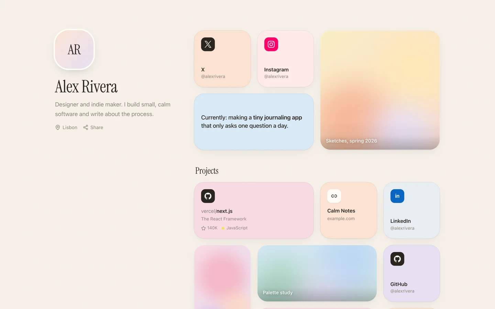
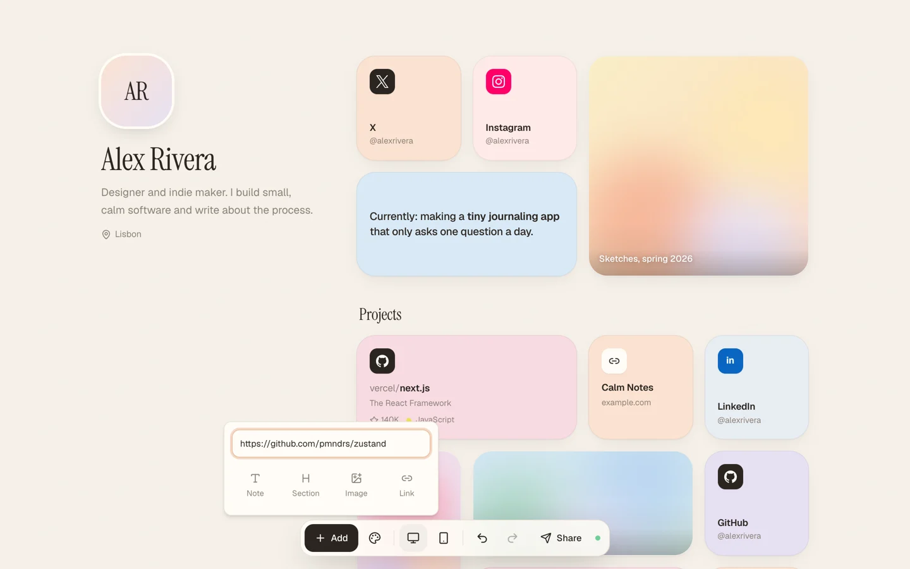
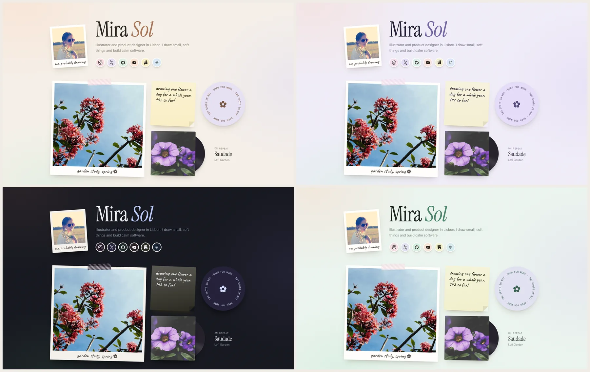

<p align="center">
  
</p>

<h1 align="center">Posy</h1>

<p align="center">A beautiful link-in-bio page you actually own.<br>Pastel themes, soft motion, one JSON file. Free and open source.</p>

---

When Linktree bought Bento and shut it down, a lot of people lost a page they loved. Posy is the
page that can't be taken away: it's open source, you can run it yourself with one Docker command,
and you can export your whole page as JSON at any time.

- **Looks good by default.** Twelve pastel and dark themes, ten font pairs, soft spring animations.
- **A calm editor.** Paste any link and it becomes the right tile. Drag to reorder. Click to edit. That's it.
- **Yours forever.** Self-host with Docker or Vercel, export your page as JSON whenever you like. No lock-in.
- **Agent friendly.** API keys, a REST API, a hosted MCP server and a CLI. The studio updates live when your agent edits the page.
- **Fast.** Server-rendered, works with JavaScript turned off, entrance animations in pure CSS.

<p align="center">
  
</p>

## Run it yourself

### Docker

```bash
docker build -t posy .
docker run -p 3000:3000 -v posy-data:/data \
  -e NEXT_PUBLIC_SITE_URL=http://localhost:3000 \
  -e BETTER_AUTH_URL=http://localhost:3000 \
  -e BETTER_AUTH_SECRET=$(openssl rand -base64 32) \
  posy
```

Or `docker compose up` (change `BETTER_AUTH_SECRET` in `docker-compose.yml` first). Open
http://localhost:3000 and sign up. **The first account owns the instance, then sign-ups close.**
Your page lives at `/` and at `/<username>`. Data (SQLite) is stored in the `/data` volume, and
migrations run on start.

### From source

```bash
npm install
npm run dev        # http://localhost:3000
```

Everything is optional locally; see [.env.example](.env.example).

### Configuration

| Variable | Default | What it does |
|---|---|---|
| `NEXT_PUBLIC_SITE_URL` | `http://localhost:3000` | Public URL (share links, OG images) |
| `BETTER_AUTH_URL` / `BETTER_AUTH_SECRET` | | Required in production. Secret: `openssl rand -base64 32` |
| `POSY_SIGNUP` | `first-user` | `open` lets anyone sign up, `closed` disables sign-up |
| `POSY_ROOT` | `owner-page` | `marketing` shows a landing page at `/` instead (for a hosted multi-user site) |
| `POSY_DATA_DIR` | `~/.posy` in dev, `.data` in production (`/data` in Docker) | Where the SQLite file and uploads live |
| `DATABASE_URL`, `DATABASE_AUTH_TOKEN` | local file | Use Turso / libSQL instead |
| `BLOB_READ_WRITE_TOKEN` | | Vercel Blob for uploads on Vercel |
| `GITHUB_CLIENT_ID/SECRET`, `GOOGLE_CLIENT_ID/SECRET` | | Enable social sign-in |
| `GITHUB_TOKEN` | | Higher GitHub API limit for repo tiles |

## Using the studio

Sign in and open **Edit**.

| | |
|---|---|
| **Add** | Press <kbd>Add</kbd>, or paste a link anywhere on the page. Profiles, YouTube, Spotify, GitHub repos, images and emails are recognised automatically. |
| **Arrange** | Drag tiles. Pick a size: small, wide, tall or large. |
| **Style** | Theme, backgrounds, tile styles, fonts, corners and layout, from the palette button. |
| **Undo** | <kbd>⌘Z</kbd> / <kbd>⇧⌘Z</kbd>. <kbd>Delete</kbd> removes the selected tile, <kbd>Esc</kbd> deselects. |
| **Publish** | Edits are saved to a draft. **Publish** makes them live. |
| **Share** | QR code and link for your page. |

Dashboard pages: **Analytics** (views and clicks per tile), **Agents** (API keys and setup snippets),
**Settings** (change username, export your page as JSON, delete your account).

<p align="center">
  
</p>

## Themes

Cream · Lavender · Mint · Sky · Peach · Paper · Blush · Sage · Midnight · Mocha · Dusk · Ocean, plus any accent colour, backgrounds, tile styles, hover effects and font pairs.

<p align="center">
  
</p>

## Tiles

| Tile | What it shows |
|---|---|
| Link | Favicon, title and an optional preview image |
| Social | 29 platforms (X, Instagram, GitHub, LinkedIn, YouTube, TikTok, Bluesky, Threads, Substack…) and email |
| Note | Short text with **bold**, *italic* and links |
| Section | A heading that starts a new group of tiles |
| Image | Your photo or artwork, with an optional caption and link |
| Video | YouTube, loads only when played |
| Music | Spotify embed |
| GitHub | A repo with live stars and language, refreshed daily |

## Edit with your AI agent

Create an API key on the **Agents** page, then connect your agent to the hosted MCP server:

```bash
claude mcp add --transport http posy http://localhost:3000/api/mcp \
  --header "Authorization: Bearer posy_..."
```

Ask it, for example, *"add my repo owner/name as a wide tile and switch to the lavender theme, then
publish"*. If the studio is open, the change appears within seconds. There's also a REST API
(`/api/v1/page`), a public JSON view of any page (`/api/v1/public/<username>`), `llms.txt` pages,
and a CLI:

```bash
export POSY_URL=http://localhost:3000 POSY_API_KEY=posy_...
npm run posy -- add https://x.com/you
npm run posy -- theme --preset midnight --tiles glass
npm run posy -- publish
```

See [docs/ai-agents.md](docs/ai-agents.md).

## Deploying

- **Docker** anywhere (see above). Mount `/data`.
- **Vercel**: import the repo, set `DATABASE_URL` + `DATABASE_AUTH_TOKEN` (Turso), `BLOB_READ_WRITE_TOKEN`,
  `BETTER_AUTH_SECRET` and `NEXT_PUBLIC_SITE_URL`. Migrations run on start.

## Built with

Next.js 16 · React 19 · TypeScript · Tailwind CSS 4 · Motion · dnd-kit · shadcn/ui · Better Auth ·
Drizzle + libSQL · Zod · MCP

## Contributing

Issues and pull requests are welcome. See [CONTRIBUTING.md](CONTRIBUTING.md).

## License

[MIT](LICENSE)
