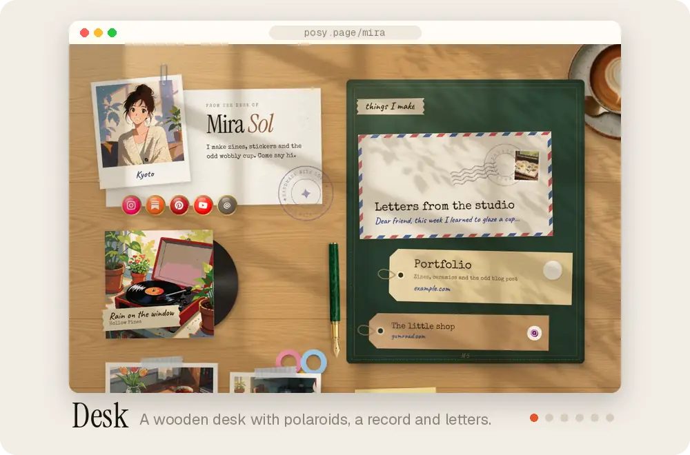
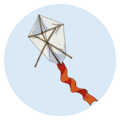
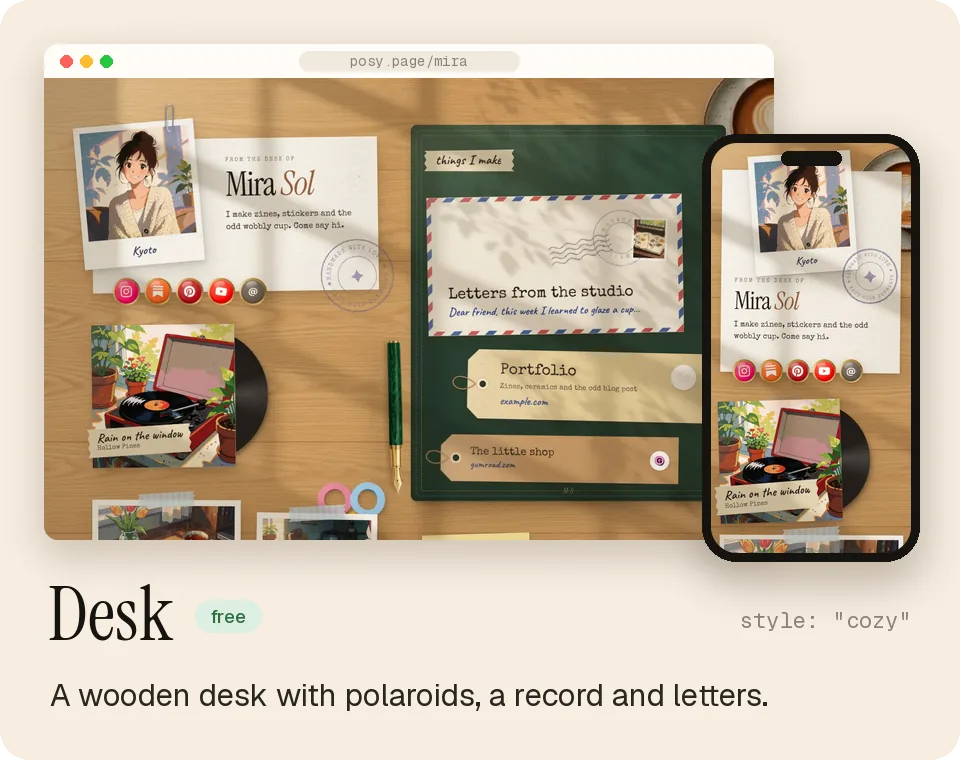
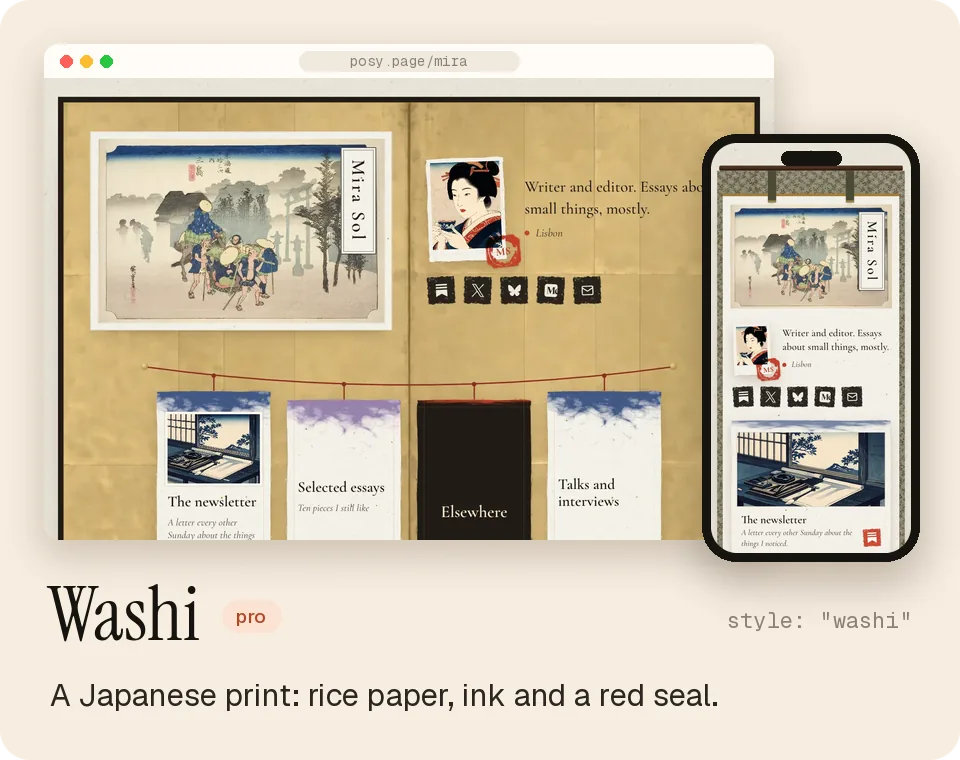
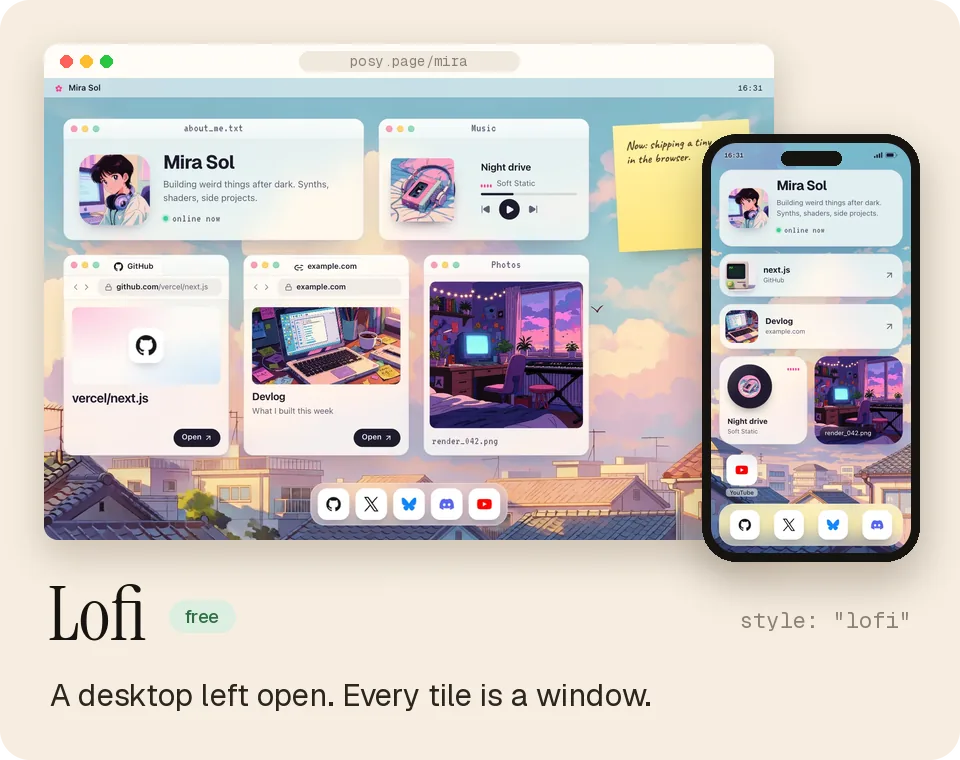
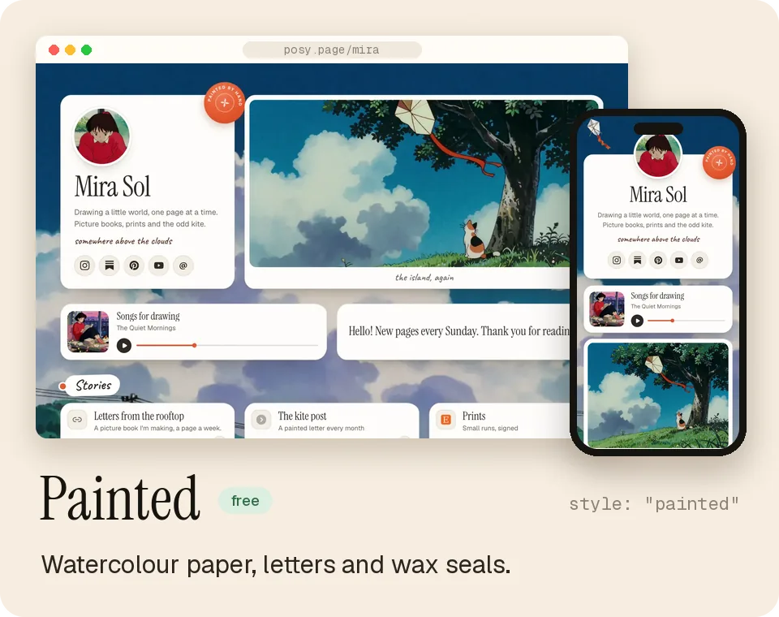
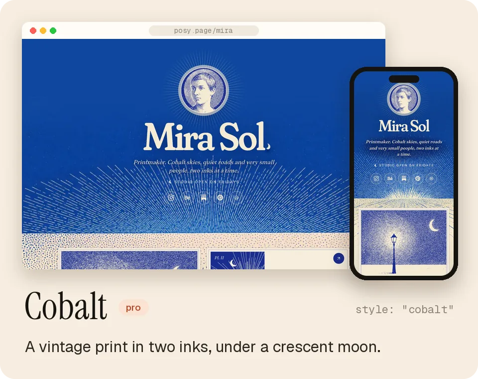
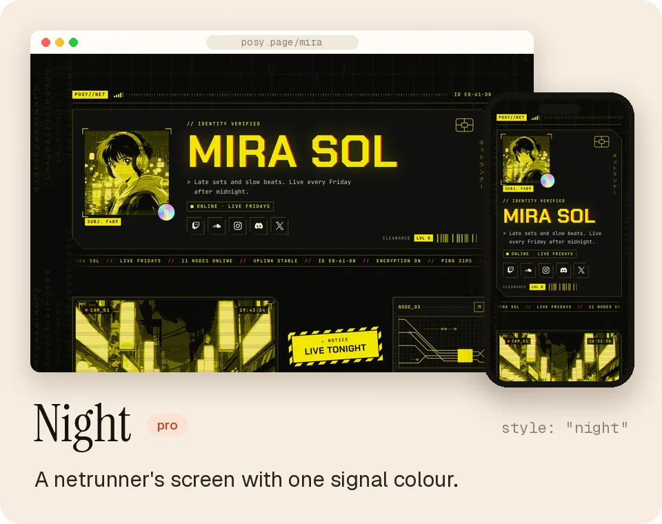
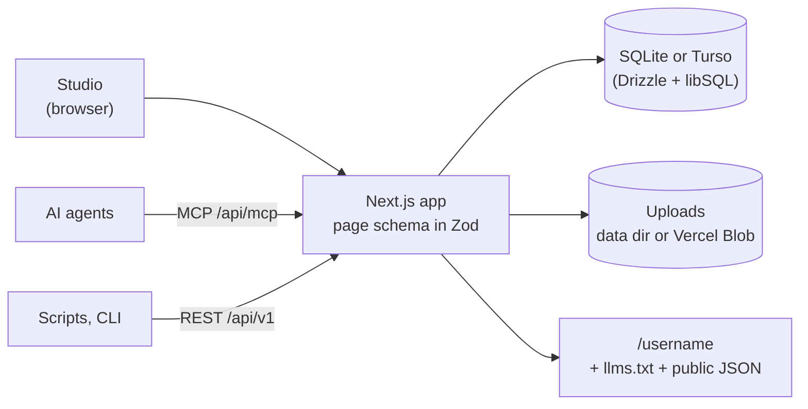

<a href="https://posy.page">
  
</a>

<p align="center">
  Six hand-made looks, a calm editor, and a page that is one JSON file.<br>
  Free and open source. Hosted at <a href="https://posy.page">posy.page</a>, or run it yourself.
</p>

<p align="center">
  <a href="https://github.com/Himanshu-Sangshetti/posy/actions/workflows/ci.yml"></a>
  <a href="LICENSE"></a>
  <a href="CHANGELOG.md"></a>
  <a href="https://registry.modelcontextprotocol.io/v0.1/servers/io.github.Himanshu-Sangshetti%2Fposy/versions/latest"></a>
  <a href="https://docs.posy.page"></a>
  <a href="https://github.com/Himanshu-Sangshetti/posy/stargazers"></a>
</p>

<p align="center">
  <a href="https://posy.page"><b>Website</b></a> ·
  <a href="https://docs.posy.page"><b>Docs</b></a> ·
  <a href="#for-ai-agents"><b>MCP</b></a> ·
  <a href="#self-hosting"><b>Self-host</b></a> ·
  <a href="CONTRIBUTING.md"><b>Contributing</b></a>
</p>

<p align="center">
  <picture>
    <source media="(prefers-color-scheme: dark)" srcset=".github/assets/looks-tour-dark.webp">
    
  </picture>
</p>

## What is Posy

Posy makes a link-in-bio page that feels like a place: a desk with polaroids and a spinning record, a Japanese print, a desktop left open, a watercolour sky.
You edit it in a calm studio, or ask your AI to.

<table>
  <tr>
    <td align="center" width="33%" valign="top">
      <br>
      <b>Looks you would make by hand</b><br>
      <sub>Six looks, four palettes each. The same tiles become polaroids, prints, windows or letters.</sub>
    </td>
    <td align="center" width="33%" valign="top">
      <br>
      <b>Ready for your AI</b><br>
      <sub>A hosted MCP server, a REST API, <code>llms.txt</code>, and a page file any chat can write.</sub>
    </td>
    <td align="center" width="33%" valign="top">
      <br>
      <b>Yours to keep</b><br>
      <sub>MIT licensed. Self-host with Docker or Vercel, and move your page between servers in two clicks.</sub>
    </td>
  </tr>
</table>

## Six looks

Each look draws the same tiles its own way. Pick one in the studio, or set `look` in the page file.

<table>
  <tr>
    <td width="50%">
      <picture>
        <source media="(prefers-color-scheme: dark)" srcset=".github/assets/look-desk-dark.webp">
        
      </picture>
    </td>
    <td width="50%">
      <picture>
        <source media="(prefers-color-scheme: dark)" srcset=".github/assets/look-washi-dark.webp">
        
      </picture>
    </td>
  </tr>
  <tr>
    <td width="50%">
      <picture>
        <source media="(prefers-color-scheme: dark)" srcset=".github/assets/look-lofi-dark.webp">
        
      </picture>
    </td>
    <td width="50%">
      <picture>
        <source media="(prefers-color-scheme: dark)" srcset=".github/assets/look-painted-dark.webp">
        
      </picture>
    </td>
  </tr>
  <tr>
    <td width="50%">
      <picture>
        <source media="(prefers-color-scheme: dark)" srcset=".github/assets/look-cobalt-dark.webp">
        
      </picture>
    </td>
    <td width="50%">
      <picture>
        <source media="(prefers-color-scheme: dark)" srcset=".github/assets/look-night-dark.webp">
        
      </picture>
    </td>
  </tr>
</table>

On posy.page, Desk and Cobalt are free, and Washi, Lofi, Painted and Night come with Pro. Self-hosted, every look is unlocked.
See them live in the [looks gallery](https://docs.posy.page/looks).

<details>
<summary><b>Tiles, palettes and layouts</b></summary>
<br>

| Tile | What it shows |
|---|---|
| Link | Favicon, title and an optional preview image |
| Social | 29 platforms (X, Instagram, GitHub, LinkedIn, YouTube, TikTok, Bluesky, Threads, Substack…) and email |
| Note | Short text with **bold**, *italic* and links |
| Section | A heading that starts a new group of tiles |
| Image | Your photo or artwork, with an optional caption and link |
| Video | YouTube, loads only when played |
| Music | Spotify embed |
| GitHub | A repo with live stars and language, refreshed daily |

Three layouts: `bento` (a grid), `list` (one column) and `canvas` (place tiles freely). Photos can be printed `natural`, `mono`, `dither` or `ascii`.
On top of each look's palettes: Cream, Lavender, Mint, Sky, Peach, Paper, Blush, Sage, Midnight, Mocha, Dusk and Ocean, any accent colour, and font pairs.

In the studio, paste a link anywhere to add a tile, drag to arrange, and press <kbd>⌘Z</kbd> to undo. Edits stay in a draft until you press **Publish**.

</details>

## Quickstart

**On posy.page.** Sign up at [posy.page](https://posy.page). Your page is live in a minute.

**With Docker.**

```bash
git clone https://github.com/Himanshu-Sangshetti/posy.git && cd posy
docker build -t posy . && docker run -p 3000:3000 -v posy-data:/data \
  -e NEXT_PUBLIC_SITE_URL=http://localhost:3000 -e BETTER_AUTH_URL=http://localhost:3000 \
  -e BETTER_AUTH_SECRET=$(openssl rand -base64 32) posy
```

Open http://localhost:3000 and sign up. The first account owns the instance, and `/` becomes your page.

**From source.** Node 22 or 24.

```bash
npm install
npm run dev        # http://localhost:3000
```

Nothing needs configuring locally. Your data lives in `~/.posy` (set `POSY_DATA_DIR` to move it).

## For AI agents

Posy is built to be edited by an AI. Everything an agent does lands in your draft; nothing goes live until you, or it, call `publish`.

```text
https://posy.page/api/mcp
```

<p>
  <a href="https://cursor.com/en/install-mcp?name=posy&config=eyJ1cmwiOiJodHRwczovL3Bvc3kucGFnZS9hcGkvbWNwIn0%3D">
    <picture>
      <source media="(prefers-color-scheme: dark)" srcset="https://cursor.com/deeplink/mcp-install-light.svg">
      
    </picture>
  </a>
</p>

- **Claude and ChatGPT:** add a custom connector with the URL above and sign in to Posy. Step by step: [Connect an AI](https://docs.posy.page/agents/connect).
- **Claude Code:** `claude mcp add --transport http posy https://posy.page/api/mcp`, then `/mcp` → **Authenticate**.
- **Codex:** `codex mcp add posy --url https://posy.page/api/mcp`
- **Scripts:** use an API key from the **Agents** page as `Authorization: Bearer posy_...`.

It is listed in the [official MCP registry](https://registry.modelcontextprotocol.io/v0.1/servers/io.github.Himanshu-Sangshetti%2Fposy/versions/latest) as `io.github.Himanshu-Sangshetti/posy`. On your own server, swap in `https://YOUR-POSY/api/mcp`.

**No connector? Use a link.** Any chat that can write text can hand you a page. It opens a live preview, with no sign-in, and one button makes it yours:

```text
https://posy.page/new?name=Mira%20Sol&look=washi&links=https://github.com/mira,hi@mira.so
```

**Or a page file.** A whole page is one small JSON file. Paste it at [posy.page/new](https://posy.page/new), import it in the studio, or send it through the API.

```json
{
  "posy": 1,
  "name": "Mira Sol",
  "bio": "Illustrator making small, soft things",
  "look": "washi",
  "theme": "kinari",
  "links": [
    { "heading": "Find me" },
    "https://github.com/mira",
    "hi@mira.so",
    { "url": "https://mira.so/portfolio", "title": "Portfolio", "size": "w" },
    { "stamp": "Say hello" }
  ]
}
```

<details>
<summary><b>MCP tools, REST, llms.txt and the CLI</b></summary>
<br>

| Tool | What it does |
|---|---|
| `get_page` | Your draft, public URL, and what to do next |
| `create_page` | Claim a username and create your page (once) |
| `import_page` | Load a whole page from a page file |
| `add_tile` | Add one link, or many at once. Posy picks the right tile |
| `update_tile`, `move_tile`, `remove_tile` | Change, reorder or delete a tile |
| `set_theme`, `set_profile` | Look, colours, fonts, name and bio |
| `publish` | Make the draft live |
| `list_options` | Allowed looks, palettes, fonts and sizes |

| Surface | Where |
|---|---|
| REST | `/api/v1/page` with a Bearer key. Spec: [`/openapi.json`](https://posy.page/openapi.json), guide: [API reference](https://docs.posy.page/api-reference/introduction) |
| Public JSON | `/api/v1/public/<username>` for any published page |
| `llms.txt` | [`posy.page/llms.txt`](https://posy.page/llms.txt) for the app, `/<username>/llms.txt` for any page |
| Schemas | [`schema/page.schema.json`](schema/page.schema.json) and `/schema/brief.schema.json` |
| Plugin | Claude Code and Cursor skills in [`plugin/`](plugin) |

```bash
export POSY_URL=https://posy.page POSY_API_KEY=posy_...
npm run posy -- add https://github.com/owner/repo --size w
npm run posy -- theme --preset moonlit --layout list
npm run posy -- publish
```

Full guide: [docs/ai-agents.md](docs/ai-agents.md). Working on this repo with a coding agent? Read [AGENTS.md](AGENTS.md).

</details>

## Self-hosting

[](https://vercel.com/new/clone?repository-url=https%3A%2F%2Fgithub.com%2FHimanshu-Sangshetti%2Fposy&env=BETTER_AUTH_SECRET,NEXT_PUBLIC_SITE_URL,BETTER_AUTH_URL,DATABASE_URL,DATABASE_AUTH_TOKEN,BLOB_READ_WRITE_TOKEN&envDescription=Secret%20(openssl%20rand%20-base64%2032)%2C%20your%20public%20URL%2C%20a%20Turso%20database%20and%20a%20Vercel%20Blob%20token&envLink=https%3A%2F%2Fgithub.com%2FHimanshu-Sangshetti%2Fposy%2Fblob%2Fmain%2Fdocs%2Fself-hosting.md)

Run Posy on Docker, on Vercel with Turso and Blob, or on any Node server. Everything is unlocked: every look, palette and font,
analytics with CSV export, your own domain, and no badge.

```bash
docker compose up    # change BETTER_AUTH_SECRET in docker-compose.yml first
```

Data (SQLite and uploads) lives in the `/data` volume, and migrations run on start. **The first account owns the instance, then sign-ups close.**
Custom domains, backups and upgrades: [self-hosting guide](https://docs.posy.page/self-host/guide).

<details>
<summary><b>Configuration</b></summary>
<br>

| Variable | Default | What it does |
|---|---|---|
| `NEXT_PUBLIC_SITE_URL` | `http://localhost:3000` | Public URL (share links, OG images) |
| `BETTER_AUTH_URL` / `BETTER_AUTH_SECRET` | | Required in production. Secret: `openssl rand -base64 32` |
| `POSY_SIGNUP` | `first-user` | `open` lets anyone sign up, `closed` disables sign-up |
| `POSY_DATA_DIR` | `~/.posy` in dev, `.data` in production (`/data` in Docker) | Where the SQLite file and uploads live |
| `DATABASE_URL`, `DATABASE_AUTH_TOKEN` | local file | Use Turso / libSQL instead |
| `BLOB_READ_WRITE_TOKEN` | | Vercel Blob for uploads on Vercel |
| `GITHUB_CLIENT_ID/SECRET`, `GOOGLE_CLIENT_ID/SECRET` | | Social sign-in |
| `GITHUB_TOKEN` | | Higher GitHub API limit for repo tiles |
| `POSY_TELEMETRY` | on in production | `0` turns off anonymous usage counts ([what is sent](docs/telemetry.md)) |

All of them, with comments: [.env.example](.env.example).

</details>

<details>
<summary><b>Self-hosted or posy.page?</b></summary>
<br>

| | Self-hosted | posy.page Free | posy.page Pro |
|---|---|---|---|
| Tiles, editor, API, MCP, CLI | All | All | All |
| Looks | All six | Desk, Cobalt | All six |
| Your own domain | Yes, point it at your server | No | Yes, HTTPS set up for you |
| Analytics | 12 months + CSV | Basic | 12 months + CSV |
| "Made with Posy" footer | Hide it | Shown | Hide it |
| Setup and upkeep | You | None | None |

Pro is $5 a month or $48 a year. Your page is one JSON file and works the same on both:
**Settings → Download page.json** on one, **Import page.json** on the other. The import lands in your draft, so nothing changes until you publish.

</details>

## How it's built

Next.js 16 · React 19 · TypeScript · Tailwind CSS 4 · Motion · dnd-kit · shadcn/ui · Better Auth · Drizzle + libSQL · Zod · MCP



One schema, `src/lib/schema.ts`, describes a page. It drives the JSON Schema, the REST API, the MCP tools and the editor, so they never drift apart.

| Where | What |
|---|---|
| `src/components/page/styles/` | The six looks, one `.tsx` + `.css` each |
| `src/components/studio/` | The editor |
| `src/app/api/` | REST (`v1`), MCP (`mcp`), auth and uploads |
| `src/lib/` | Schema, looks, palettes, fonts, link detection |

## Contributing

Issues and pull requests are welcome. Start with [CONTRIBUTING.md](CONTRIBUTING.md).

- **Add a look.** A look is a `.tsx` and a `.css` file plus a lab page to check it in every palette. The steps: [Adding a look](CONTRIBUTING.md#adding-a-look).
- **Pick up an issue.** [Good first issues](https://github.com/Himanshu-Sangshetti/posy/labels/good%20first%20issue) and [look ideas](https://github.com/Himanshu-Sangshetti/posy/labels/look) are a nice place to begin.
- **Before a PR:** `npm run check`, `npm test`, and `npm run e2e` for UI changes.

## Community, security and licence

- Questions and ideas: [issues](https://github.com/Himanshu-Sangshetti/posy/issues). Please follow the [Code of Conduct](CODE_OF_CONDUCT.md).
- Found a vulnerability? See [SECURITY.md](SECURITY.md) and report it privately.
- Posy is [MIT](LICENSE) licensed. The art that ships with the looks is public domain, CC0, or made for Posy; every file and its source is in [public/looks/CREDITS.md](public/looks/CREDITS.md).
  Some of it was generated with Krea 2, whose community licence allows commercial use only while your company makes under US$1M a year. Read the note in the credits file first.
- Brand files and colours: [BRAND.md](BRAND.md).

<br>

<a href="https://posy.page">
  
</a>

<p align="center"><sub>Made by hand, with a cat asleep on the desk.</sub></p>
