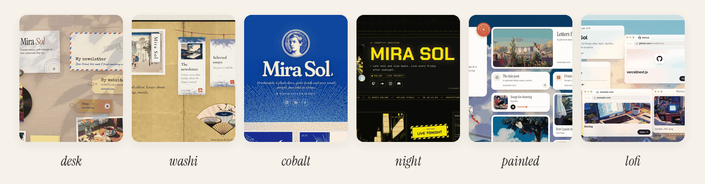

<p align="center">
  
</p>

<h1 align="center">Posy</h1>

<p align="center">A beautiful link-in-bio page you own.<br>Six hand-made looks, soft motion, one JSON file. Free and open source.</p>

<p align="center">
  <a href="https://github.com/Himanshu-Sangshetti/posy/actions/workflows/ci.yml"></a>
  <a href="LICENSE"></a>
  <a href="CHANGELOG.md"></a>
  <a href="docs/ai-agents.md"></a>
</p>

<p align="center">
  <a href="https://posy.page">posy.page</a> ·
  <a href="https://docs.posy.page">Docs</a> ·
  <a href="docs/self-hosting.md">Self-host</a> ·
  <a href="CONTRIBUTING.md">Contribute</a>
</p>

<p align="center">
  
</p>

---

Posy makes a link-in-bio page that feels like a place: a desk with polaroids and a spinning record,
a Japanese print, a desktop left open, a watercolour sky. You edit it in a calm studio, or ask your AI agent to.
It is open source, and your page is one JSON file you can take anywhere.

- **Six looks**, each with four palettes: Desk, Washi, Lofi, Painted, Cobalt and Night.
- **An editor** you can use on a phone: paste a link to add a tile, drag to arrange, undo anything.
- **Built for agents**: a hosted MCP server, a REST API, a CLI, `llms.txt` and a JSON Schema.
- **Yours**: self-host with Docker, or use [posy.page](https://posy.page). Move between them in two clicks.

## Quickstart

**Use posy.page.** Sign up at [posy.page](https://posy.page) and your page is live in a minute.

**Self-host with Docker.**

```bash
git clone https://github.com/Himanshu-Sangshetti/posy.git && cd posy
docker build -t posy . && docker run -p 3000:3000 -v posy-data:/data \
  -e NEXT_PUBLIC_SITE_URL=http://localhost:3000 -e BETTER_AUTH_URL=http://localhost:3000 \
  -e BETTER_AUTH_SECRET=$(openssl rand -base64 32) posy
```

Open http://localhost:3000 and sign up. The first account owns the instance. More options are in [Run it yourself](#run-it-yourself).

**From source.** Node 22 or newer.

```bash
npm install
npm run dev        # http://localhost:3000
```

## Agents

Make an API key on the **Agents** page, then connect your agent to the MCP server:

| | |
|---|---|
| MCP URL | `https://posy.page/api/mcp` (or `https://YOUR-POSY/api/mcp`) |
| Page file | One JSON file with a [JSON Schema](schema/page.schema.json). See [docs/format.md](docs/format.md). |
| `llms.txt` | `https://posy.page/llms.txt` for the app, and `/<username>/llms.txt` for any page |
| Plugin | Claude Code and Cursor: see [`plugin/`](plugin) |

```bash
claude mcp add --transport http posy https://posy.page/api/mcp \
  --header "Authorization: Bearer posy_..."
```

Ask it, for example, *"add my repo owner/name as a wide tile, switch to the Washi look, then publish"*.
If the studio is open, the change appears within seconds. Agents edit your draft; nothing goes live until `publish`.
There is also a REST API (`/api/v1/page`), a public JSON view of every page (`/api/v1/public/<username>`) and a CLI:

```bash
export POSY_URL=https://posy.page POSY_API_KEY=posy_...
npm run posy -- add https://x.com/you
npm run posy -- theme --preset midnight --tiles glass
npm run posy -- publish
```

Full guide: [docs/ai-agents.md](docs/ai-agents.md). Working in this repo with a coding agent? Read [AGENTS.md](AGENTS.md).

## Two ways to use Posy

**Run it yourself.** Download Posy and host it on your own server or domain. Everything is
unlocked: every layout, theme and font, analytics with CSV export, your own domain, no badge to remove.
The first account you create owns the instance, and `/` is your page.

**Use posy.page.** The same app, hosted by us. Sign up and your page is live in a minute. Nothing to
install, update or back up. There is a free plan, and Pro ($5/month or $48/year) adds the extras below.

| | Self-hosted | posy.page Free | posy.page Pro |
|---|---|---|---|
| Layouts, tiles, editor, API, MCP, CLI | All | All | All |
| Premium themes and fonts | Yes | No | Yes |
| Your own domain | Yes, point it at your server | No | Yes, HTTPS set up for you |
| Analytics | 12 months + CSV | Basic | 12 months + CSV |
| "Made with Posy" footer | Hide it | Shown | Hide it |
| Setup and upkeep | You | None | None |
| Support | GitHub issues | GitHub issues | Priority |

### Moving between them

Your page is one JSON file, and it works the same on both. In **Settings**, press **Download page.json**
on one and **Import page.json** on the other. The import lands in your draft, so nothing changes
on your live page until you press Publish. Photos you uploaded are saved as full links, so they keep
loading from the old server; keep it running until you have re-uploaded them.

The REST API, the MCP server and the CLI are the same on both too. Point `POSY_URL` at whichever one you use:

```bash
POSY_URL=https://posy.page POSY_API_KEY=posy_... npm run posy -- export page.json
POSY_URL=https://my.server POSY_API_KEY=posy_... npm run posy -- import page.json
```

## Run it yourself

[](https://vercel.com/new/clone?repository-url=https%3A%2F%2Fgithub.com%2FHimanshu-Sangshetti%2Fposy&env=BETTER_AUTH_SECRET,NEXT_PUBLIC_SITE_URL,BETTER_AUTH_URL,DATABASE_URL,DATABASE_AUTH_TOKEN,BLOB_READ_WRITE_TOKEN&envDescription=Secret%20(openssl%20rand%20-base64%2032)%2C%20your%20public%20URL%2C%20a%20Turso%20database%20and%20a%20Vercel%20Blob%20token&envLink=https%3A%2F%2Fgithub.com%2FHimanshu-Sangshetti%2Fposy%2Fblob%2Fmain%2Fdocs%2Fself-hosting.md)

### Docker

```bash
docker build -t posy .
docker run -p 3000:3000 -v posy-data:/data \
  -e NEXT_PUBLIC_SITE_URL=http://localhost:3000 \
  -e BETTER_AUTH_URL=http://localhost:3000 \
  -e BETTER_AUTH_SECRET=$(openssl rand -base64 32) \
  posy
```

Or `docker compose up` (change `BETTER_AUTH_SECRET` in `docker-compose.yml` first). Open
http://localhost:3000 and sign up. **The first account owns the instance, then sign-ups close.**
Data (SQLite) lives in the `/data` volume, and migrations run on start.

Docker Compose, Vercel with Turso and Blob, custom domains, backups and upgrades are in
[docs/self-hosting.md](docs/self-hosting.md).

### From source

```bash
npm install
npm run dev        # http://localhost:3000
```

Node 22 or 24 is recommended (some dependencies list them in their `engines`).

Everything is optional locally; see [.env.example](.env.example).

In development your data (the SQLite file and uploads) lives in `~/.posy`, outside the repo, so saving it doesn't reload the dev server.
To keep it somewhere else, set `POSY_DATA_DIR`, for example `POSY_DATA_DIR=./.data npm run dev`.

### Configuration

| Variable | Default | What it does |
|---|---|---|
| `NEXT_PUBLIC_SITE_URL` | `http://localhost:3000` | Public URL (share links, OG images) |
| `BETTER_AUTH_URL` / `BETTER_AUTH_SECRET` | | Required in production. Secret: `openssl rand -base64 32` |
| `POSY_SIGNUP` | `first-user` | `open` lets anyone sign up, `closed` disables sign-up |
| `POSY_DATA_DIR` | `~/.posy` in dev, `.data` in production (`/data` in Docker) | Where the SQLite file and uploads live |
| `DATABASE_URL`, `DATABASE_AUTH_TOKEN` | local file | Use Turso / libSQL instead |
| `BLOB_READ_WRITE_TOKEN` | | Vercel Blob for uploads on Vercel |
| `GITHUB_CLIENT_ID/SECRET`, `GOOGLE_CLIENT_ID/SECRET` | | Enable social sign-in |
| `GITHUB_TOKEN` | | Higher GitHub API limit for repo tiles |

## Using the studio

Sign in and open **Edit**.

| | |
|---|---|
| **Add** | Press <kbd>Add</kbd>, or paste a link anywhere on the page. Profiles, YouTube, Spotify, GitHub repos, images and emails are recognised automatically. |
| **Arrange** | Drag tiles. Pick a size: small, wide, tall or large. |
| **Style** | Theme, backgrounds, tile styles, fonts, corners and layout, from the palette button. |
| **Undo** | <kbd>⌘Z</kbd> / <kbd>⇧⌘Z</kbd>. <kbd>Delete</kbd> removes the selected tile, <kbd>Esc</kbd> deselects. |
| **Publish** | Edits are saved to a draft. **Publish** makes them live. |
| **Share** | QR code and link for your page. |

Dashboard pages: **Analytics** (views and clicks per tile), **Agents** (API keys and setup snippets),
**Settings** (change username, download or import your page as JSON, delete your account).

<p align="center">
  
</p>

## Looks and themes

Six looks: Desk, Washi, Lofi, Painted, Cobalt and Night. Each one draws the same tiles its own way and has four palettes. On top of that you get these colour themes:

Cream · Lavender · Mint · Sky · Peach · Paper · Blush · Sage · Midnight · Mocha · Dusk · Ocean, plus any accent colour, backgrounds, tile styles, hover effects and font pairs.

<p align="center">
  
</p>

## Tiles

| Tile | What it shows |
|---|---|
| Link | Favicon, title and an optional preview image |
| Social | 29 platforms (X, Instagram, GitHub, LinkedIn, YouTube, TikTok, Bluesky, Threads, Substack…) and email |
| Note | Short text with **bold**, *italic* and links |
| Section | A heading that starts a new group of tiles |
| Image | Your photo or artwork, with an optional caption and link |
| Video | YouTube, loads only when played |
| Music | Spotify embed |
| GitHub | A repo with live stars and language, refreshed daily |

## Self-hosting

Docker, Docker Compose, Vercel with Turso and Blob, custom domains, backups and upgrades are in
[docs/self-hosting.md](docs/self-hosting.md). `package.json` is marked `private` on purpose: Posy is an app, not an npm package.

## Telemetry

A self-hosted Posy sends a few anonymous usage counts (no content, no URLs, no usernames) so we know how it is used. Exactly what is sent, and how to turn it off with `POSY_TELEMETRY=0`, is in [docs/telemetry.md](docs/telemetry.md).

## Documentation

[docs.posy.page](https://docs.posy.page) has the quickstart, self-hosting, the page file, the API and MCP.
The Markdown sources are in [`docs/`](docs).

## Built with

Next.js 16 · React 19 · TypeScript · Tailwind CSS 4 · Motion · dnd-kit · shadcn/ui · Better Auth ·
Drizzle + libSQL · Zod · MCP

## Contributing

Issues and pull requests are welcome. Start with [CONTRIBUTING.md](CONTRIBUTING.md), including how to add a look.
Please follow the [Code of Conduct](CODE_OF_CONDUCT.md). To report a vulnerability, see [SECURITY.md](SECURITY.md).

## Licence and art credits

Posy is [MIT](LICENSE) licensed. The art that ships with the looks is public domain, CC0, or made for Posy.
Every file and its source is in [public/looks/CREDITS.md](public/looks/CREDITS.md).
Some of the art was generated with Krea 2. Its community licence allows commercial use of those images only while your company
makes under US$1M a year; read the note in the credits file before you use them in a commercial product.
