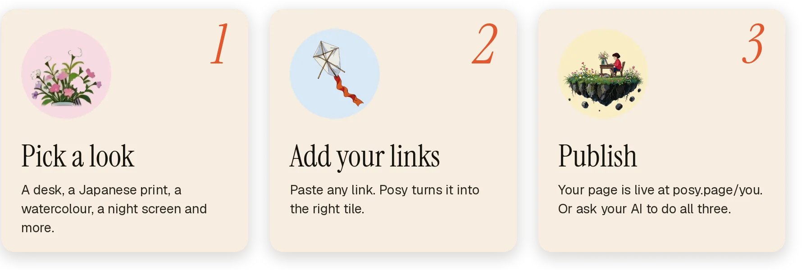
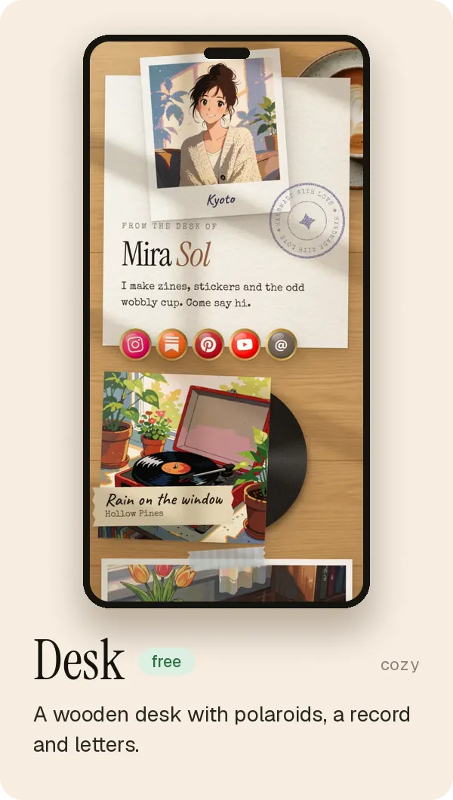
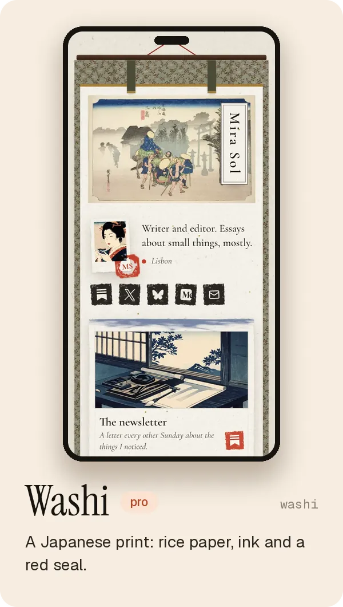
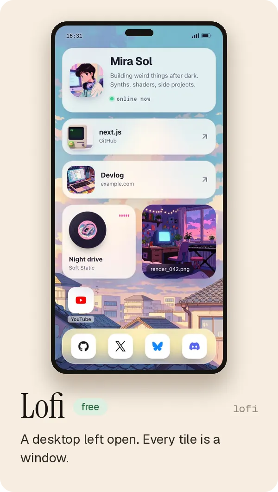
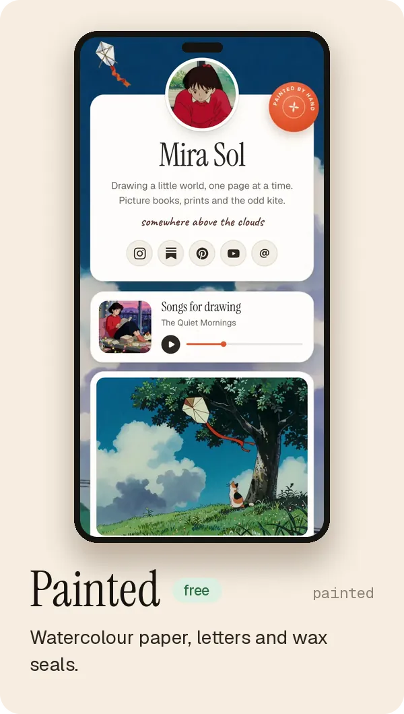
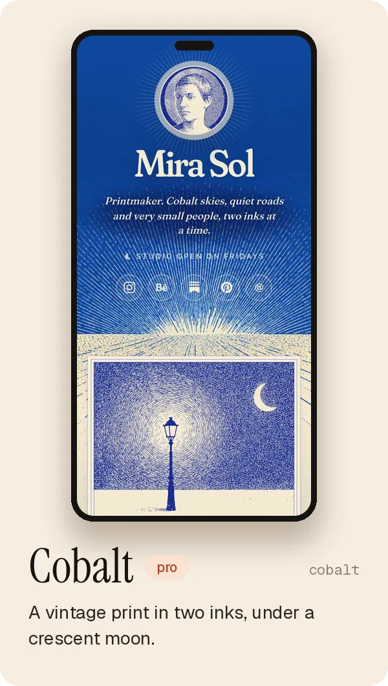
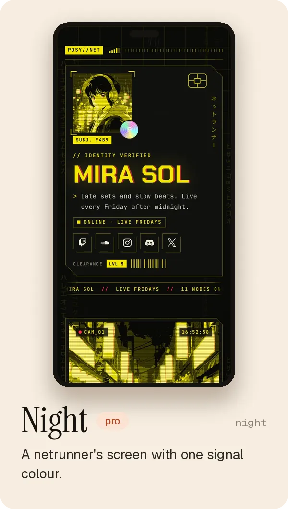
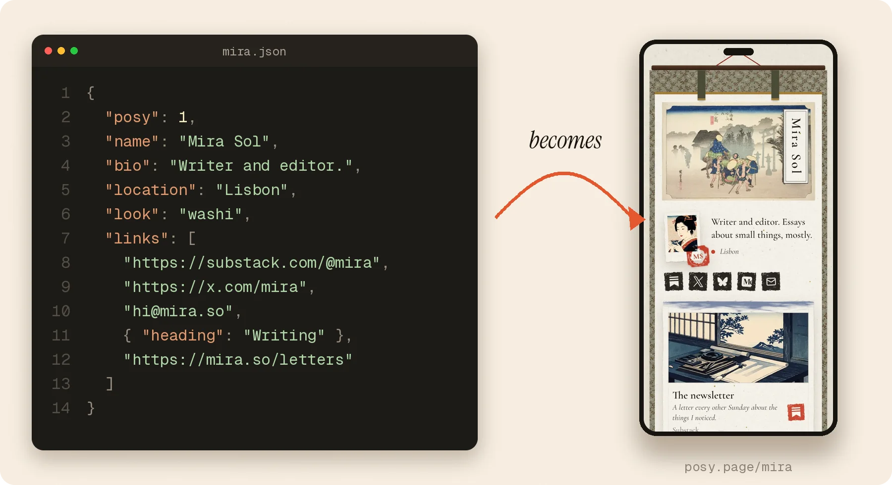
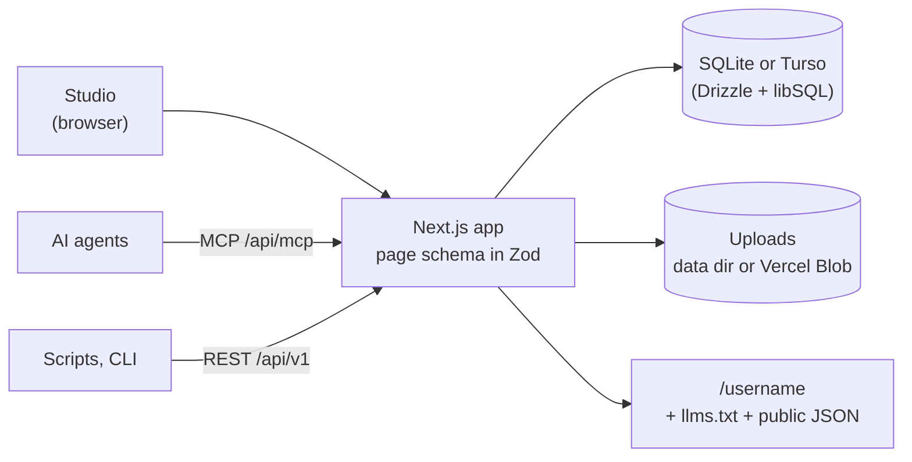

<a href="https://posy.page">
  
</a>

<h3 align="center">Posy is a link-in-bio page that looks hand-made.</h3>

<p align="center">
  Pick a look, add your links, publish. Edit it yourself, or let your AI do it.<br>
  Free and open source. Use it at <a href="https://posy.page">posy.page</a> or run it yourself.
</p>

<p align="center">
  <a href="https://github.com/Himanshu-Sangshetti/posy/actions/workflows/ci.yml"></a>
  <a href="LICENSE"></a>
  <a href="CHANGELOG.md"></a>
  <a href="https://registry.modelcontextprotocol.io/v0.1/servers/io.github.Himanshu-Sangshetti%2Fposy/versions/latest"></a>
  <a href="https://docs.posy.page"></a>
  <a href="https://github.com/Himanshu-Sangshetti/posy/stargazers"></a>
</p>

<p align="center">
  <a href="https://posy.page"><b>Website</b></a> ·
  <a href="https://docs.posy.page"><b>Docs</b></a> ·
  <a href="#connect-your-ai"><b>Connect your AI</b></a> ·
  <a href="#run-it-yourself"><b>Self-host</b></a> ·
  <a href="CONTRIBUTING.md"><b>Contributing</b></a>
</p>

<p align="center">
  <a href="https://cursor.com/en/install-mcp?name=posy&amp;config=eyJ1cmwiOiJodHRwczovL3Bvc3kucGFnZS9hcGkvbWNwIn0%3D"><picture><source media="(prefers-color-scheme: dark)" srcset=".github/assets/badges/cursor-dark.png"></picture></a>
  <a href="https://insiders.vscode.dev/redirect?url=vscode%3Amcp%2Finstall%3F%257B%2522name%2522%253A%2522posy%2522%252C%2522type%2522%253A%2522http%2522%252C%2522url%2522%253A%2522https%253A%252F%252Fposy.page%252Fapi%252Fmcp%2522%257D"><picture><source media="(prefers-color-scheme: dark)" srcset=".github/assets/badges/vscode-dark.png"></picture></a>
  <a href="https://insiders.vscode.dev/redirect?url=vscode-insiders%3Amcp%2Finstall%3F%257B%2522name%2522%253A%2522posy%2522%252C%2522type%2522%253A%2522http%2522%252C%2522url%2522%253A%2522https%253A%252F%252Fposy.page%252Fapi%252Fmcp%2522%257D"><picture><source media="(prefers-color-scheme: dark)" srcset=".github/assets/badges/vscode-insiders-dark.png"></picture></a>
  <a href="https://claude.ai/customize/connectors?modal=add-custom-connector&amp;connectorName=Posy&amp;connectorUrl=https%3A%2F%2Fposy.page%2Fapi%2Fmcp"><picture><source media="(prefers-color-scheme: dark)" srcset=".github/assets/badges/claude-dark.png"></picture></a>
  <a href="https://goose-docs.ai/extension?type=streamable_http&amp;url=https%3A%2F%2Fposy.page%2Fapi%2Fmcp&amp;id=posy&amp;name=Posy&amp;description=Make%20and%20edit%20your%20Posy%20page"><picture><source media="(prefers-color-scheme: dark)" srcset=".github/assets/badges/goose-dark.png"></picture></a>
  <a href="https://docs.posy.page/agents/connect#chatgpt"><picture><source media="(prefers-color-scheme: dark)" srcset=".github/assets/badges/chatgpt-dark.png"></picture></a>
</p>

<p align="center"></p>

## What is Posy

Posy is a link-in-bio page that looks hand-made. You pick a look, add your links, and publish.
Edit it yourself in a calm studio, or ask your AI to do it for you. Your page is one small JSON file you can take anywhere.

<picture>
  <source media="(prefers-color-scheme: dark)" srcset=".github/assets/how-dark.webp">
  
</picture>

<p align="center"></p>

## The looks

The same links, drawn as a wooden desk with polaroids, a Japanese print, a desktop left open, a watercolour, a two-ink print or a netrunner's screen.
Each look has four palettes, and you can switch any time.

<p align="center">
<picture>
  <source media="(prefers-color-scheme: dark)" srcset=".github/assets/looks-tour-dark.webp">
  
</picture>
</p>

<table>
  <tr>
    <td width="33%"><picture><source media="(prefers-color-scheme: dark)" srcset=".github/assets/phone-desk-dark.webp"></picture></td>
    <td width="33%"><picture><source media="(prefers-color-scheme: dark)" srcset=".github/assets/phone-washi-dark.webp"></picture></td>
    <td width="33%"><picture><source media="(prefers-color-scheme: dark)" srcset=".github/assets/phone-lofi-dark.webp"></picture></td>
  </tr>
  <tr>
    <td width="33%"><picture><source media="(prefers-color-scheme: dark)" srcset=".github/assets/phone-painted-dark.webp"></picture></td>
    <td width="33%"><picture><source media="(prefers-color-scheme: dark)" srcset=".github/assets/phone-cobalt-dark.webp"></picture></td>
    <td width="33%"><picture><source media="(prefers-color-scheme: dark)" srcset=".github/assets/phone-night-dark.webp"></picture></td>
  </tr>
</table>

On posy.page, Painted, Desk and Lofi are free, and the others come with Pro. Self-hosted, every look is unlocked.
See them live in the [looks gallery](https://docs.posy.page/looks).

<details>
<summary><b>See each look on a desktop</b></summary>
<br>

<table>
  <tr>
    <td width="50%"><picture><source media="(prefers-color-scheme: dark)" srcset=".github/assets/look-desk-dark.webp"></picture></td>
    <td width="50%"><picture><source media="(prefers-color-scheme: dark)" srcset=".github/assets/look-washi-dark.webp"></picture></td>
  </tr>
  <tr>
    <td width="50%"><picture><source media="(prefers-color-scheme: dark)" srcset=".github/assets/look-lofi-dark.webp"></picture></td>
    <td width="50%"><picture><source media="(prefers-color-scheme: dark)" srcset=".github/assets/look-painted-dark.webp"></picture></td>
  </tr>
  <tr>
    <td width="50%"><picture><source media="(prefers-color-scheme: dark)" srcset=".github/assets/look-cobalt-dark.webp"></picture></td>
    <td width="50%"><picture><source media="(prefers-color-scheme: dark)" srcset=".github/assets/look-night-dark.webp"></picture></td>
  </tr>
</table>

</details>

<details>
<summary><b>Tiles, palettes and layouts</b></summary>
<br>

| Tile | What it shows |
|---|---|
| Link | Favicon, title and an optional preview image |
| Social | 29 platforms (X, Instagram, GitHub, LinkedIn, YouTube, TikTok, Bluesky, Threads, Substack…) and email |
| Note | Short text with **bold**, *italic* and links |
| Section | A heading that starts a new group of tiles |
| Image | Your photo or artwork, with an optional caption and link |
| Video | YouTube, loads only when played |
| Music | Spotify embed |
| GitHub | A repo with live stars and language, refreshed daily |

Three layouts: `bento` (a grid), `list` (one column) and `canvas` (place tiles freely). Photos can be printed `natural`, `mono`, `dither` or `ascii`.
On top of each look's palettes: Cream, Lavender, Mint, Sky, Peach, Paper, Blush, Sage, Midnight, Mocha, Dusk and Ocean, any accent colour, and font pairs.

</details>

<p align="center"></p>

## Make your page

**Claim your name at [posy.page](https://posy.page).** Paste a link anywhere to add a tile, drag to arrange, and press **Publish**. Your page is live in a minute.

**Just looking?** Open [posy.page/new](https://posy.page/new), paste a few links and see your page before you sign up.

<details>
<summary><b>Free, Pro and self-hosted</b></summary>
<br>

| | posy.page Free | posy.page Pro | Self-hosted |
|---|---|---|---|
| Tiles, editor, API, MCP, CLI | All | All | All |
| Looks | Painted, Desk, Lofi | All | All |
| Your own domain | No | Yes, HTTPS set up for you | Yes, point it at your server |
| Analytics | Basic | 12 months + CSV | 12 months + CSV |
| "Made with Posy" footer | Shown | Hide it | Hide it |
| Setup and upkeep | None | None | You |

Pro is $5 a month or $48 a year. Your page works the same everywhere: **Settings → Download page.json** on one, **Import page.json** on the other.

</details>

<p align="center"></p>

## Connect your AI

Posy has a hosted MCP server, so your AI can make and edit your page. You sign in with your Posy account; there is no key to copy.
Everything it does lands in your draft, and nothing goes live until you, or it, publish.

```text
https://posy.page/api/mcp
```

**One click**

<p>
  <a href="https://cursor.com/en/install-mcp?name=posy&amp;config=eyJ1cmwiOiJodHRwczovL3Bvc3kucGFnZS9hcGkvbWNwIn0%3D"><picture><source media="(prefers-color-scheme: dark)" srcset=".github/assets/badges/cursor-dark.png"></picture></a>
  <a href="https://insiders.vscode.dev/redirect?url=vscode%3Amcp%2Finstall%3F%257B%2522name%2522%253A%2522posy%2522%252C%2522type%2522%253A%2522http%2522%252C%2522url%2522%253A%2522https%253A%252F%252Fposy.page%252Fapi%252Fmcp%2522%257D"><picture><source media="(prefers-color-scheme: dark)" srcset=".github/assets/badges/vscode-dark.png"></picture></a>
  <a href="https://insiders.vscode.dev/redirect?url=vscode-insiders%3Amcp%2Finstall%3F%257B%2522name%2522%253A%2522posy%2522%252C%2522type%2522%253A%2522http%2522%252C%2522url%2522%253A%2522https%253A%252F%252Fposy.page%252Fapi%252Fmcp%2522%257D"><picture><source media="(prefers-color-scheme: dark)" srcset=".github/assets/badges/vscode-insiders-dark.png"></picture></a>
  <a href="https://claude.ai/customize/connectors?modal=add-custom-connector&amp;connectorName=Posy&amp;connectorUrl=https%3A%2F%2Fposy.page%2Fapi%2Fmcp"><picture><source media="(prefers-color-scheme: dark)" srcset=".github/assets/badges/claude-dark.png"></picture></a>
  <a href="https://goose-docs.ai/extension?type=streamable_http&amp;url=https%3A%2F%2Fposy.page%2Fapi%2Fmcp&amp;id=posy&amp;name=Posy&amp;description=Make%20and%20edit%20your%20Posy%20page"><picture><source media="(prefers-color-scheme: dark)" srcset=".github/assets/badges/goose-dark.png"></picture></a>
</p>

**A few steps**

<p>
  <a href="https://docs.posy.page/agents/connect#chatgpt"><picture><source media="(prefers-color-scheme: dark)" srcset=".github/assets/badges/chatgpt-dark.png"></picture></a>
  <a href="https://docs.posy.page/agents/connect#claude-code"><picture><source media="(prefers-color-scheme: dark)" srcset=".github/assets/badges/claude-code-dark.png"></picture></a>
  <a href="https://docs.posy.page/agents/connect#cursor-vs-code-codex"><picture><source media="(prefers-color-scheme: dark)" srcset=".github/assets/badges/codex-dark.png"></picture></a>
</p>

```bash
claude mcp add --transport http posy https://posy.page/api/mcp   # Claude Code, then /mcp → Authenticate
codex mcp add posy --url https://posy.page/api/mcp               # Codex
```

In ChatGPT, open **Plugins**, press **+**, choose **Add custom MCP server**, paste the URL and pick OAuth.
On your own server, use `https://YOUR-POSY/api/mcp`. Posy is in the [official MCP registry](https://registry.modelcontextprotocol.io/v0.1/servers/io.github.Himanshu-Sangshetti%2Fposy/versions/latest) as `io.github.Himanshu-Sangshetti/posy`.

### No connector? Hand it a page file

Any chat can write your page as one small JSON file. Paste it at [posy.page/new](https://posy.page/new) and it becomes a page.

<picture>
  <source media="(prefers-color-scheme: dark)" srcset=".github/assets/page-file-dark.webp">
  
</picture>

Or skip the file: an AI can hand you a link that opens a live preview, no sign-in needed.

```text
https://posy.page/new?name=Mira%20Sol&look=washi&links=https://github.com/mira,hi@mira.so
```

<details>
<summary><b>The page file, MCP tools, REST, llms.txt and the CLI</b></summary>
<br>

```json
{
  "posy": 1,
  "name": "Mira Sol",
  "bio": "Writer and editor.",
  "location": "Lisbon",
  "look": "washi",
  "links": [
    "https://substack.com/@mira",
    "https://x.com/mira",
    "hi@mira.so",
    { "heading": "Writing" },
    "https://mira.so/letters"
  ]
}
```

Every field: [the page file](https://docs.posy.page/agents/format).

| Tool | What it does |
|---|---|
| `get_page` | Your draft, public URL, and what to do next |
| `create_page` | Claim a username and create your page (once) |
| `import_page` | Load a whole page from a page file |
| `add_tile` | Add one link, or many at once. Posy picks the right tile |
| `update_tile`, `move_tile`, `remove_tile` | Change, reorder or delete a tile |
| `set_theme`, `set_profile` | Look, colours, fonts, name and bio |
| `publish` | Make the draft live |
| `list_options` | Allowed looks, palettes, fonts and sizes |

| Surface | Where |
|---|---|
| REST | `/api/v1/page` with a Bearer key from the **Agents** page. Spec: [`/openapi.json`](https://posy.page/openapi.json), guide: [API reference](https://docs.posy.page/api-reference/introduction) |
| Public JSON | `/api/v1/public/<username>` for any published page |
| `llms.txt` | [`posy.page/llms.txt`](https://posy.page/llms.txt) for the app, `/<username>/llms.txt` for any page |
| Schemas | [`schema/page.schema.json`](schema/page.schema.json) and `/schema/brief.schema.json` |
| Plugin | Claude Code and Cursor skills in [`plugin/`](plugin) |

```bash
export POSY_URL=https://posy.page POSY_API_KEY=posy_...
npm run posy -- add https://github.com/owner/repo --size w
npm run posy -- theme --preset moonlit --layout list
npm run posy -- publish
```

Full guide: [docs/ai-agents.md](docs/ai-agents.md). Working on this repo with a coding agent? Read [AGENTS.md](AGENTS.md).

</details>

<p align="center"></p>

## Run it yourself

<a href="https://vercel.com/new/clone?repository-url=https%3A%2F%2Fgithub.com%2FHimanshu-Sangshetti%2Fposy&amp;env=BETTER_AUTH_SECRET,NEXT_PUBLIC_SITE_URL,BETTER_AUTH_URL,DATABASE_URL,DATABASE_AUTH_TOKEN,BLOB_READ_WRITE_TOKEN&amp;envDescription=Secret%20(openssl%20rand%20-base64%2032)%2C%20your%20public%20URL%2C%20a%20Turso%20database%20and%20a%20Vercel%20Blob%20token&amp;envLink=https%3A%2F%2Fgithub.com%2FHimanshu-Sangshetti%2Fposy%2Fblob%2Fmain%2Fdocs%2Fself-hosting.md"></a>

Or with Docker:

```bash
git clone https://github.com/Himanshu-Sangshetti/posy.git && cd posy
docker build -t posy . && docker run -p 3000:3000 -v posy-data:/data \
  -e NEXT_PUBLIC_SITE_URL=http://localhost:3000 -e BETTER_AUTH_URL=http://localhost:3000 \
  -e BETTER_AUTH_SECRET=$(openssl rand -base64 32) posy
```

Open http://localhost:3000 and sign up: the first account owns the instance, and every look is unlocked.
Domains, backups and every setting: [self-hosting guide](https://docs.posy.page/self-host/guide) · [.env.example](.env.example)

## Built with

Next.js 16 · React 19 · TypeScript · Tailwind CSS 4 · Motion · dnd-kit · shadcn/ui · Better Auth · Drizzle + libSQL · Zod · MCP

One schema, `src/lib/schema.ts`, describes a page. It drives the JSON Schema, the REST API, the MCP tools and the editor, so they never drift apart.

<details>
<summary><b>How the pieces fit</b></summary>
<br>



| Where | What |
|---|---|
| `src/components/page/styles/` | The looks, one `.tsx` + `.css` each |
| `src/components/studio/` | The editor |
| `src/app/api/` | REST (`v1`), MCP (`mcp`), auth and uploads |
| `src/lib/` | Schema, looks, palettes, fonts, link detection |

From source: `npm install && npm run dev` (Node 22 or 24). Your local data lives in `~/.posy`.

</details>

## Contributing

Issues and pull requests are welcome. Start with [CONTRIBUTING.md](CONTRIBUTING.md).

- **Add a look.** A look is a `.tsx` and a `.css` file plus a lab page to check it in every palette. The steps: [Adding a look](CONTRIBUTING.md#adding-a-look).
- **Pick up an issue.** [Good first issues](https://github.com/Himanshu-Sangshetti/posy/labels/good%20first%20issue) and [look ideas](https://github.com/Himanshu-Sangshetti/posy/labels/look) are a nice place to begin.
- **Before a PR:** `npm run check`, `npm test`, and `npm run e2e` for UI changes.

## Community, security and licence

- Questions and ideas: [issues](https://github.com/Himanshu-Sangshetti/posy/issues). Please follow the [Code of Conduct](CODE_OF_CONDUCT.md).
- Found a vulnerability? See [SECURITY.md](SECURITY.md) and report it privately.
- Posy is [MIT](LICENSE) licensed. The art that ships with the looks is public domain, CC0, or made for Posy; every file and its source is in [public/looks/CREDITS.md](public/looks/CREDITS.md).
  Some of it was generated with Krea 2, whose community licence allows commercial use only while your company makes under US$1M a year. Read the note in the credits file first.
- Brand files and colours: [BRAND.md](BRAND.md).

<br>

<a href="https://posy.page">
  
</a>

<p align="center"><sub>Made by hand, with a cat asleep on the desk.</sub></p>
